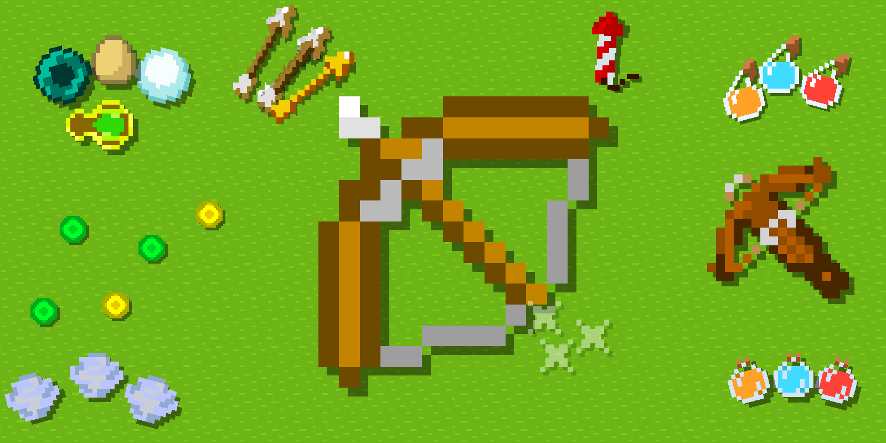

  

  
  
  
  
  

# Trajectory Projected

**See where it lands, and how far the spread can carry it.**

Trajectory Projected is a client-side mod for Minecraft **26.2 / Fabric** that
shows where your bow, crossbow, trident or thrown item will land. The flight is
simulated tick by tick in the order vanilla uses, from the same position and
rotation the server will fire with, so the line follows the real arrow rather
than an approximation of it.

Every shot also carries the server's random spread, which no line can show. Around
the hit, a spread zone falls on the blocks like a shadow and marks where the
projectile can actually land.

Nothing is released yet; the first version is in preparation.

## What it shows

**Projectiles**

- **Bow** while drawn, at the draw it would fire with.
- **Crossbow** when charged: arrows, Multishot volleys with every arrow on its own
  path, and firework rockets.
- **Trident** while readied. A trident with Riptide, which launches you instead,
  shows nothing.
- **Thrown items**: snowballs, eggs, ender pearls, splash and lingering potions,
  bottles o' enchanting and wind charges.

**The line**

- A dotted path that keeps an even spacing on screen, near and far, and stays
  steady while you move.
- Parts hidden behind blocks are drawn faint and outlined, so the path never
  disappears behind a wall.
- In first person the line starts beside the view, from the hand that throws, and
  bends into the flight. Crossbow lines start at the eyes.
- A rocket's lifetime is random: its line fades out after the earliest moment it
  can explode.

**The target**

- A hit marker on the surface the projectile will meet.
- On a mob or a player the marker becomes a cross, the line pulses gently, and the
  crosshair turns into a cross.
- **Spread zone**: a soft shade with a thin rim on the blocks around the hit. It
  wraps over steps and walls, leaves out what other blocks shield from the
  projectile, and its inner ring marks where about half of the shots land. A ring for
  90% of the shots and an allowance for draw timing on servers can be turned on, and
  each part has its own switch.

**Honest by design**

- Only what the client already knows is shown. The mod never aims, shoots or picks
  targets for you.
- Where the outcome is unknown, it shows less rather than a confident wrong line:
  the path stops at chunks that are not loaded, and Multishot volleys whose spread
  depends on conditions only the server can check show only the arrow that flies
  straight regardless.
- A shot into water shows no zone where its spread scatters too widely to say where
  the arrow lands, as near a shore.

## Getting started

Install **Fabric Loader 0.19.3+**, **Fabric API 0.161.0+26.2** and **Java 25**,
then place the Trajectory Projected JAR in your Minecraft instance's `mods` folder.
Nothing needs to be installed on the server.

Press **F7** in-game to open settings. A key to turn trajectories on and off can be
set under **Options → Controls → Key Binds → Trajectory Projected**.

Settings are grouped into General, Line and Target: the lead-in from the side, dot
size and spacing, dimming far away, the path behind blocks, the spread zone, the
hit marker and the cues on living targets each have their own switch. Search works
across all pages; hover a setting for details. Changes save automatically. English
and Russian translations are included.

## Compatibility

Built for Minecraft **26.2** with Fabric. I play with **Sodium** (0.9.2 tested).

With **Iris** (1.11.4 tested) and a shader pack active, the line, markers and spread
zone are drawn over the pack's finished image, so they look the same as without
shaders and stay sharp; they are not lit or fogged by the pack. Checked with
Complementary Reimagined r5.8.1 and BSL v10.1.8. Without a pack, Iris changes
nothing.

Other rendering mods have not been tested.

On multiplayer I have tested one small server of my own; the results are under
[Accuracy](#accuracy). Plugins and custom rules can change what a server fires. Some
servers don't allow mods like this one, so check the rules of the server you play on.

## Accuracy

The simulation follows vanilla's own code: the launch, the order of operations in
each tick, water, entity hitboxes and the random spread. Unit tests compare it with
vanilla's formulas, which says nothing about the game itself, so I also measured it
in game.

I fired 334 logged bow shots and compared each prediction with the launch the server
sent and with where the arrow stopped. The first 30 partial draws on the server
exposed a bug in how the mod counted the draw. It is fixed, and the table shows the
series fired after the fix instead.

| Conditions | Shots | Launch within vanilla's spread limit | Largest flight error, blocks |
|---|---|---|---|
| Singleplayer, standing, 25–59 blocks | 92 | 92 | 0.049 |
| Singleplayer, moving, jumping, partial draw, 12–73 blocks | 92 | 92 | 0.009 |
| Server, full draw, standing and strafing | 60 | 60 | 0.009 |
| Server, partial draw, 9–15 blocks | 60 | 38 | 0.002 |

Flight error is how far the arrow stopped from a simulation started from the launch
the server actually sent, so it leaves out the random spread. Apart from one shot at
0.049 blocks, which I can't explain, it stayed under 0.01.

The random spread is what you see in practice. Standing in singleplayer, arrows
stopped a median of 0.6 blocks from the predicted point at 25 blocks, 1.6 at 43 and
1.3 at 59, and never more than 4.6. Zero misses in 184 singleplayer launches puts the
real rate below about 1.6% (95% confidence).

### Spread on servers

At full draw a server behaved like singleplayer. A partial draw is different: the
client and the server count the draw separately, and in 22 of those 60 shots the
server counted one tick more or less than the client. Those 22 are all the launches
outside the limit in the table. The client can't know when this happens. The likely
cause is that client and server ticks aren't in step, but I haven't confirmed that.

A tick matters because a partial draw gains power with every tick. At 9–15 blocks, a
shot a tick off stopped about 1.1–1.4 blocks from the prediction, up to 2.1, while
shots with a matching count stopped a median of 0.14–0.24 blocks away. At full draw
the power no longer changes, so a tick makes no difference.

**Allow for draw timing**, on the Target page and off by default, widens the spread
zone to cover a tick more or less as well. The zone gets larger and busier, so use it
if you shoot partial draws on servers. It only applies to the bow, and has no effect
in singleplayer or at full draw. Its weights (60% same tick, 20% each side) are a rough
figure from that one server, and I haven't checked the widened zone against real
shots yet.

### Limits

- The server results come from one server and one evening: about 166 ms ping and no
  other players. Other latency, server load or plugins may give different numbers.
- Only the bow has been measured this way. Other projectiles had short singleplayer
  checks: 10 crossbow arrows, 4 ender pearls and 3 tridents all landed inside their
  zones.
- The zone's rings are computed from simulated spread. I haven't counted real arrows
  against them.
- A client loses track of an arrow at about 64 blocks, so past that distance the log
  has only the arrow's last known position.

## License

The code is under the [MIT](LICENSE) license. The mod icon and the banner are
simplified recolors of Minecraft textures, which belong to Mojang, and are not covered
by that license.
